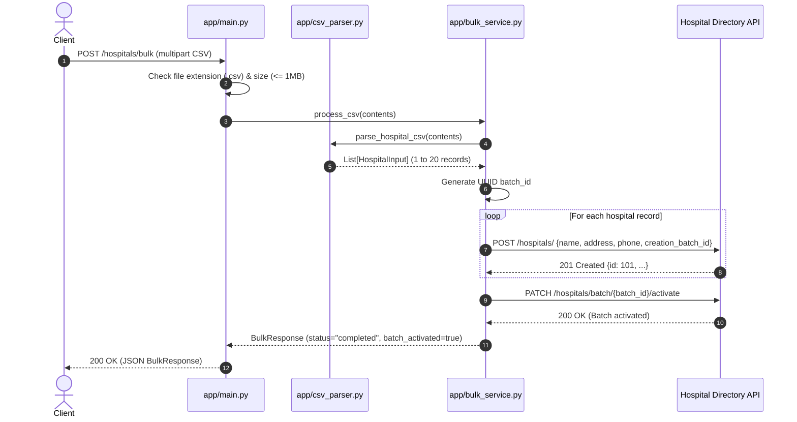
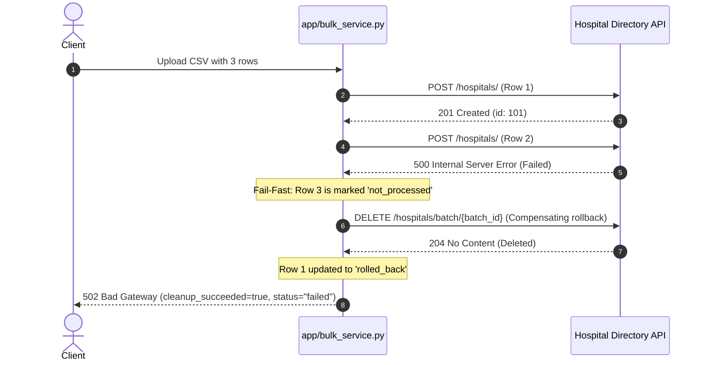

# Architecture & System Design

Technical design, component architecture, and failure semantics for the **Hospital Bulk Processor** service.

- **Live Deployment:** [https://paribus-hospital-bulk-processor-fkro.onrender.com](https://paribus-hospital-bulk-processor-fkro.onrender.com)
- **Upstream Hospital Directory API:** [https://hospital-directory.onrender.com](https://hospital-directory.onrender.com)

---

## 1. System Overview

The Hospital Bulk Processor is a stateless FastAPI microservice that acts as an orchestration and validation bridge between user CSV uploads and the upstream [Hospital Directory API](https://hospital-directory.onrender.com).

### Key Architectural Principles
1. **Stateless Middleware:** The service maintains no local database, disk persistence, or background queues. The upstream Hospital Directory API is the single source of truth.
2. **Complete Pre-Validation:** All CSV structure, column constraints, encodings, and row schemas are strictly validated in memory before any upstream HTTP requests are initiated.
3. **Transactional Batch Semantics via Compensating Actions:** Batch operations tag all created records with a shared UUID `batch_id`. The batch is activated atomically upon full success. If any creation or activation step fails, an automated compensating deletion (`DELETE /hospitals/batch/{batch_id}`) is triggered immediately.

---

## 2. Architecture Diagram

### Component Flow

```
[ Client / Web Browser / cURL ]
               │
               ▼  (HTTP POST /hospitals/bulk)
┌────────────────────────────────────────────────────────┐
│ FastAPI Application (app/main.py)                      │
│ ├── File validation (.csv check, <= 1MB size)          │
│ └── HTTP Status Code Mapping (200 / 400 / 413 / 422 / 502)
└──────────────────────────┬─────────────────────────────┘
                           │
                           ▼
┌────────────────────────────────────────────────────────┐
│ CSV Parser & Validator (app/csv_parser.py)             │
│ ├── UTF-8 / BOM normalization                          │
│ ├── Header checks (name, address, optional phone)      │
│ └── Pydantic row validation (1 to 20 hospital records) │
└──────────────────────────┬─────────────────────────────┘
                           │
                           ▼
┌────────────────────────────────────────────────────────┐
│ Bulk Orchestration Service (app/bulk_service.py)       │
│ ├── Generates unique batch_id (UUID4)                  │
│ ├── Sequential creation loop with fail-fast semantics  │
│ ├── Batch activation on all-success                    │
│ └── Automated compensating rollback on failure         │
└──────────────────────────┬─────────────────────────────┘
                           │
                           ▼
┌────────────────────────────────────────────────────────┐
│ Upstream HTTP Client (app/hospital_client.py)          │
│ ├── POST /hospitals/ (with creation_batch_id)          │
│ ├── PATCH /hospitals/batch/{batch_id}/activate         │
│ └── DELETE /hospitals/batch/{batch_id} (rollback)      │
└──────────────────────────┬─────────────────────────────┘
                           │
                           ▼  (External HTTPS)
┌────────────────────────────────────────────────────────┐
│ Upstream Hospital Directory API                        │
│ https://hospital-directory.onrender.com                │
└────────────────────────────────────────────────────────┘
```

---

## 3. Module Responsibilities

| Module | Responsibility | Key Classes / Functions |
|---|---|---|
| [`app/main.py`](file:///home/ayushman/Documents/github-projects/test2/paribus-hospital-bulk-processor/app/main.py) | Application entry point, HTTP routing, request limits (1 MB), dependency wiring, and HTTP status code translation. | `app`, `health_check()`, `bulk_create_hospitals()` |
| [`app/schemas.py`](file:///home/ayushman/Documents/github-projects/test2/paribus-hospital-bulk-processor/app/schemas.py) | Pydantic data contracts for domain inputs, creation payloads, row results, and bulk summaries. | `HospitalInput`, `HospitalCreatePayload`, `RowResult`, `BulkResponse` |
| [`app/csv_parser.py`](file:///home/ayushman/Documents/github-projects/test2/paribus-hospital-bulk-processor/app/csv_parser.py) | In-memory CSV parsing, UTF-8 decoding, duplicate header checks, column whitelisting, and strict row validation. | `parse_hospital_csv()`, `CSVValidationError` |
| [`app/bulk_service.py`](file:///home/ayushman/Documents/github-projects/test2/paribus-hospital-bulk-processor/app/bulk_service.py) | Core workflow engine: batch UUID creation, sequential creation, fail-fast termination, activation, and compensating cleanup. | `BulkHospitalService.process_csv()`, `_try_delete_batch()` |
| [`app/hospital_client.py`](file:///home/ayushman/Documents/github-projects/test2/paribus-hospital-bulk-processor/app/hospital_client.py) | Upstream HTTP adapter using asynchronous `httpx.AsyncClient` with error wrapping and timeout configuration. | `HospitalAPIClient`, `HospitalAPIError` |

---

## 4. Workflows & Sequence Diagrams

### 4.1 Successful Batch Creation and Activation



---

### 4.2 Creation Failure & Compensating Rollback

When any hospital record fails during upstream creation:
1. Creation loop immediately terminates (fail-fast).
2. Unattempted rows are tagged as `status="not_processed"`.
3. The failed row is tagged as `status="failed"`.
4. A compensating `DELETE /hospitals/batch/{batch_id}` request is sent upstream.
5. Previously created rows are marked as `status="rolled_back"`.
6. Returns HTTP 502 with full audit details.



---

### 4.3 Activation Failure & Compensating Rollback

If all hospitals are successfully created in the directory but the batch activation call fails:
1. `PATCH /hospitals/batch/{batch_id}/activate` throws `HospitalAPIError`.
2. An automated compensating `DELETE /hospitals/batch/{batch_id}` is executed.
3. All created rows are marked as `status="rolled_back"`.
4. The response status is returned as `502 Bad Gateway` with `cleanup_succeeded=true`.

---

## 5. Failure Semantics & Compensating Transactions

Because the external REST API does not provide distributed two-phase commit (2PC) or native ACID transactions across separate HTTP calls, this service implements the **Saga Pattern** with compensating actions:

1. **Pre-Validation Shield:**
   - Any bad data (missing columns, extra columns, empty rows, invalid data types, or > 20 records) is caught in `csv_parser.py`.
   - Returns **422 Unprocessable Entity** immediately.
   - Zero requests are sent to the upstream service.

2. **Isolated Batches:**
   - Every execution generates a cryptographically random UUID v4 `batch_id`.
   - All upstream records created during this run carry this tag, ensuring no collision with parallel uploads or existing records.

3. **Compensating Rollback:**
   - If an error occurs midway, `_try_delete_batch(batch_id)` deletes all records associated with that batch.
   - Prevents dormant, inactive "zombie" records from polluting upstream storage.

4. **Transparent Audit Trail:**
   - The response always reports `cleanup_attempted` and `cleanup_succeeded`.
   - If network connectivity drops during the cleanup deletion, `cleanup_succeeded` will be `false`, and the `batch_id` is preserved in the response so operators can safely investigate and reconcile.

---

## 6. Row Lifecycle State Machine

```
              ┌──────────────────────────┐
              │     CSV Row Parsed       │
              └─────────────┬────────────┘
                            │
              ┌─────────────▼────────────┐
              │     created_inactive     │
              └───────┬──────────┬───────┘
                      │          │
   (All Succeeded)    │          │  (Any Row Failed)
                      ▼          ▼
┌───────────────────────────┐  ┌─────────────┐
│   created_and_activated   │  │ rolled_back │
└───────────────────────────┘  └─────────────┘
                                      ▲
                                      │ (Compensating DELETE)
                               ┌──────┴──────┐
                               │   failed    │
                               └─────────────┘
                                      ▲
                                      │ (Subsequent rows)
                               ┌──────┴──────┐
                               │not_processed│
                               └─────────────┘
```

---

## 7. Deployment Architecture on Render

- **Platform:** Render Web Service (Free / Starter Tier)
- **Runtime:** Docker Container (`Dockerfile`) based on `python:3.12-slim`
- **Application Server:** `uvicorn app.main:app --host 0.0.0.0 --port ${PORT:-8000}`
- **Live URL:** `https://paribus-hospital-bulk-processor-fkro.onrender.com`
- **Health Check Endpoint:** `GET /` returning `{"status": "OK"}`
- **Upstream Host:** `https://hospital-directory.onrender.com`

